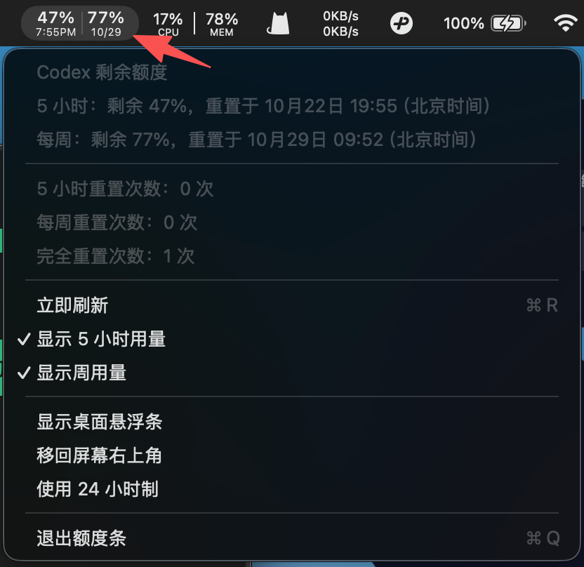
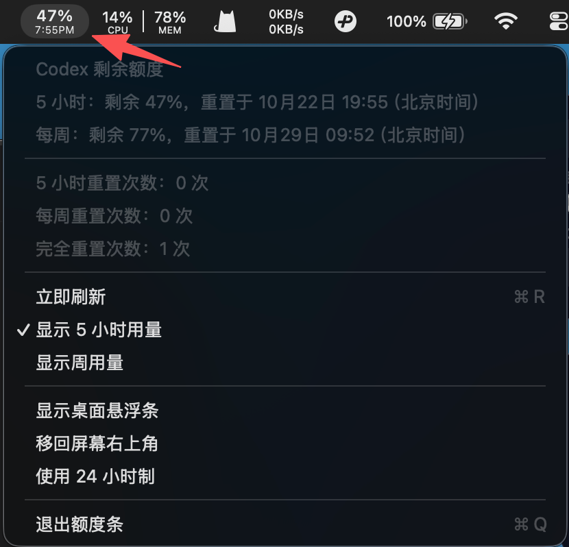

# Codex Quota Bar

English · [中文](README.md)

A small macOS menu bar app with an optional floating desktop bar for your remaining Codex quota. Built with Swift and AppKit. Quota queries use a separately installed Codex CLI. The interface supports Simplified Chinese and English, with an in-app language selector.

## Download

- [Download v1.3.0 universal macOS test build](https://github.com/Xinge2333/codex-quota-bar/releases/download/v1.3.0/CodexQuotaBar-v1.3.0-macos-universal.zip)
- [Release notes and all assets](https://github.com/Xinge2333/codex-quota-bar/releases/tag/v1.3.0)
- [SHA256SUMS](https://github.com/Xinge2333/codex-quota-bar/releases/download/v1.3.0/SHA256SUMS)

You can also copy and paste this prompt into Codex:

```text
Please help me download and configure this quota bar. Software URL: https://github.com/Xinge2333/codex-quota-bar
```

**This is an unsigned-by-Developer-ID, unnotarized test release.** It has an ad-hoc signature, but macOS Gatekeeper may block an internet download. Do not disable system security protections. If macOS refuses to open it, wait for a properly Developer ID-signed and notarized release, or review the source and build locally.

## Screenshots

Both five-hour and weekly remaining quota:



Five-hour quota only, with the weekly column independently disabled:



Screenshots are provided by the author. Values are examples captured at that time, not your current allowance. The screenshots show the Chinese interface; the current build also includes language selection, CLI selection and setup-help entries.

## Requirements

- macOS 13 or later. The universal binary contains both arm64 and x86_64 slices.
- A trusted Codex CLI installation and your own ChatGPT sign-in. Follow the [official Codex CLI documentation](https://learn.chatgpt.com/docs/codex/cli).
- Your account and CLI must support `account/rateLimits/read`. API-key-only sign-in does not necessarily provide subscription quota information.
- The packaged app does not require Python, Xcode or Homebrew. Building from source requires Xcode Command Line Tools and Python 3.
- No pet, pet plugin or running desktop chat window is required. The app starts its own local CLI helper.

Apple Silicon was tested on the development machine. The Intel slice is built but has not been run on an Intel Mac. macOS 13 is the declared deployment target, but has not been tested on a macOS 13 machine. See [the check report](CHECK_REPORT.md) and [machine-readable results](CHECKS.json).

## Install

1. Install Codex CLI using the official instructions, then run `codex login` and sign in with **your own** account. No account, token, cookie or CLI executable is bundled with this app.
2. Download and extract the ZIP. Move `额度条.app` to Applications, then open it, subject to the Gatekeeper limitation above.
3. If the app cannot find Codex CLI, run `which codex` in Terminal. In the app menu, choose **选择 Codex CLI…** (Select Codex CLI…) and select that trusted executable. This also handles custom npm, nvm and asdf installations.
4. The archive includes both Chinese and English installation instructions.

To check the download, put the ZIP and SHA256SUMS in one directory and run from that directory:

```sh
shasum -a 256 -c SHA256SUMS
```

A checksum verifies consistency with this release; it does not replace Developer ID signing or notarization.

## Interface language

Click the quota menu bar item → **语言 / Language** → **English** or **简体中文**. The menu, quota details, reset-credit labels, status messages and setup help update immediately. Your selection is saved locally and restored after restarting the app. The default is Chinese.

## Use

The large number is the **remaining percentage**, not the percentage used. The small line is the quota reset time for the five-hour window or reset date for the weekly window. **All times use Asia/Shanghai (UTC+8)**. The app refreshes every 60 seconds; an orange state means connecting or potentially stale data.

| Chinese menu item | English meaning |
| --- | --- |
| 立即刷新 | Refresh now |
| 显示 5 小时用量 | Show/hide the five-hour column |
| 显示周用量 | Show/hide the weekly column |
| 显示桌面悬浮条 / 关闭桌面悬浮条 | Show/hide the floating desktop bar |
| 移回屏幕右上角 | Move the floating bar back to the top-right |
| 使用 24 小时制 | Use a 24-hour clock |
| 选择 Codex CLI… | Select the installed CLI executable |
| 安装与登录说明… | Show setup and sign-in help |
| 语言 / Language | Switch between Simplified Chinese and English |
| 退出额度条 | Quit |

Each quota column can be toggled independently. If both are hidden, the menu bar keeps an **额度** (Quota) entry so you can enable them again. Drag the floating bar to move it; right-click it to open the menu. Your display preferences and position are stored locally. After restarting your Mac, open the app again from Applications; this version does not enable launch at login.

### Reset credits

The menu shows three independent categories of **currently available reset credits**:

- **5 小时重置次数**: five-hour-only resets.
- **每周重置次数**: weekly-only resets.
- **完全重置次数**: full resets.

One full-reset credit is counted only under full resets: **0 / 0 / 1**, never 1 / 1 / 1. These are not historical resets or scheduled window refresh counts. Incomplete or unknown details are displayed as unavailable instead of guessed. This app only reads the information; it never redeems a reset or starts model generation.

## Troubleshooting

- **CLI not found:** select the executable from the menu. An explicit `MARBLE_CODEX_PATH` environment override takes precedence over the saved selection.
- **Not signed in / no quota:** run `codex login`, check your account, and make sure your CLI supports the quota endpoint. Some accounts do not return every field.
- **Old interface:** update Codex CLI, then refresh.
- **No reset details:** the server may not provide complete credit details. Unknown counts are intentional.
- **macOS blocks the app:** this build is not notarized. Do not disable Gatekeeper to work around it.

## Build and check

```sh
bash scripts/build.sh
python3 scripts/integration_tests.py /path/to/MarbleQuotaBar
```

Build output is written to `dist/`. The build performs self-tests, signature-structure checks, a package file-allowlist check and heuristic credential/path scanning. Offline tests use synthetic helpers and no account credentials.

The executable also supports `--check-connection`. It emits only fixed status messages and capability flags, never actual percentages, reset dates, account IDs or tokens.

## Privacy and security boundaries

This app sends only initialization messages and `account/rateLimits/read` over local stdio. It has no HTTP client, analytics SDK or upload service. The CLI itself uses its own authentication, configuration and network access; this does not make the CLI offline or sandbox it to read-only permissions. Only select a trusted CLI and protect your local configuration and proxy settings.

The release excludes private account files, development logs and diagnostic screenshots. The two screenshots above are intentionally published examples supplied by the author. Preferences and the selected CLI path stay on your machine. The app does not write quota responses to files. The child environment excludes unrelated tokens and API keys.

Security scanning is heuristic, not a guarantee that every possible secret or vulnerability has been detected. Detailed Chinese reports: [SECURITY.md](SECURITY.md), [CHECK_REPORT.md](CHECK_REPORT.md).
